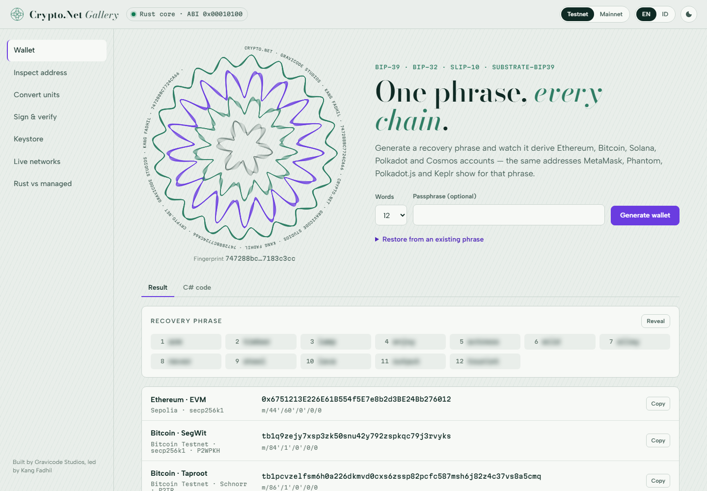

# Crypto.Net documentation

> Multi-chain cryptography and blockchain clients for .NET 10, powered by a Rust core.
> Built by Gravicode Studios, led by Kang Fadhil. · [Bahasa Indonesia](../id/index.md)

## Start here

| Page | Read it when you want to… |
| --- | --- |
| [Getting started](getting-started.md) | install the packages and make your first wallet, signature and transfer |
| [Concepts](concepts.md) | understand `Amount`, `Address`, `ISigner`, `IChainClient`, backends and errors |
| [Chains](chains.md) | use Ethereum/EVM, Bitcoin, Solana, Polkadot, Cosmos, NEAR, Aptos, Sui, TON or Cardano in depth |
| [Wallets and keys](wallet-and-keys.md) | work with mnemonics, HD derivation, xpubs and keystores |
| [Dependency injection and RPC providers](dependency-injection.md) | register clients in ASP.NET Core, add Ankr/dRPC, resilience |
| [The `cnet` CLI](cli.md) | script wallets, balances and signatures from a terminal |
| [The Gallery](gallery.md) | explore every feature interactively |
| [Architecture](architecture.md) | see how the Rust core, the C ABI and the managed fallback fit together |
| [Security](security.md) | deploy safely |
| [Contract clients](codegen.md) | generate typed C# from Solidity ABIs and Anchor IDLs |
| [Indexer](indexer.md) | index EVM events and ERC-20 transfers into a database, or crawl blocks on any chain |
| [Project templates](templates.md) | start a console app, worker, Web API, library or test project with `dotnet new` |
| [Hardware wallets](hardware-wallets.md) | sign with a Ledger: keys stay on the device |
| [VS Code extension](vscode.md) | check balances, generate clients, hover units and catch address typos in the editor |
| [Analyzers](analyzers.md) | catch hard-coded keys, float amounts and other mistakes at compile time |
| [Building and contributing](contributing.md) | build from source, run tests, release packages |
| [FAQ](faq.md) | find quick answers |
| [Notebooks](../../samples/notebooks/README.md) | learn each chain interactively in Polyglot Notebooks |

## What is supported

| | Bitcoin | Ethereum / EVM | Solana | Polkadot / Substrate | Cosmos SDK |
| --- | --- | --- | --- | --- | --- |
| Curve / scheme | secp256k1 ECDSA, BIP-340 Schnorr | secp256k1 ECDSA | Ed25519 | sr25519, Ed25519 | secp256k1 ECDSA |
| Addresses | P2PKH, P2SH, P2WPKH, P2WSH, P2TR | EIP-55 | Base58, PDA, ATA | SS58 (any prefix) | Bech32 (any HRP) |
| HD paths | BIP-44/84/86, xpub/zpub | BIP-44 (MetaMask) | SLIP-10 (Phantom) | substrate-bip39 `//hard/soft` | BIP-44 coin 118 |
| Transactions | Legacy, SegWit v0, Taproot key/script path; PSBT v0/v2; multisig; coin selection | Legacy (EIP-155), EIP-2930, EIP-1559; ERC-4337 user operations | Legacy and v0 messages with lookup tables: System, SPL Token, ATA, Compute Budget, Memo, ALT | Extrinsic v4 built from live runtime metadata | `SIGN_MODE_DIRECT`: bank, staking, distribution |
| Off-chain signing | — | EIP-191, EIP-712 | Ed25519 messages | Polkadot.js `signRaw` | — |
| RPC | Esplora REST | JSON-RPC | JSON-RPC | JSON-RPC | REST (LCD) |
| Tokens | — | ERC-20 | SPL Token | native balance | bank balances |

| | NEAR | Aptos | Sui | TON | Cardano |
| --- | --- | --- | --- | --- | --- |
| Curve / scheme | Ed25519 | Ed25519 | Ed25519 (intents) | Ed25519 | Ed25519 (BIP32-Ed25519) |
| Addresses | implicit (hex) and named accounts | AIP-40 hex | 0x + 64 hex | raw `0:` and user-friendly `EQ…`/`UQ…` | Bech32 base/enterprise/reward, Byron |
| HD paths | SLIP-10 `m/44'/397'` | SLIP-10 `m/44'/637'` (Petra) | SLIP-10 `m/44'/784'` | TON mnemonic; SLIP-10 `m/44'/607'` | CIP-1852 (Icarus) |
| Transactions | Borsh, all 8 actions | BCS entry functions, simulation | BCS programmable transactions | Cells/BoC, wallets V4R2 and W5 | Conway CBOR, native assets, CIP-20 |
| RPC | JSON-RPC | REST | GraphQL | TON Center v2/v3 | Koios REST |
| Tokens | NEP-141 via view/function calls | coins and fungible assets | coin objects | jettons | native assets |

Networks built in: Ethereum, Sepolia, Hoodi, Polygon, Arbitrum, Optimism, Base, BNB Chain, Avalanche, local Anvil;
Bitcoin mainnet/testnet/signet/regtest; Solana mainnet/devnet/testnet/local; Polkadot, Kusama, their Asset Hubs,
Westend, Paseo, local; Cosmos Hub (+ testnet), Osmosis (+ testnet), local `simd`; NEAR, Aptos, Sui and TON mainnets
and testnets; Cardano mainnet, preprod and preview. Run `cnet networks` for the list.

Roadmap items (indexer, WalletConnect, hardware wallets, VS Code extension, templates, mobile Gallery) are tracked
in [PLAN.md](../../PLAN.md).
