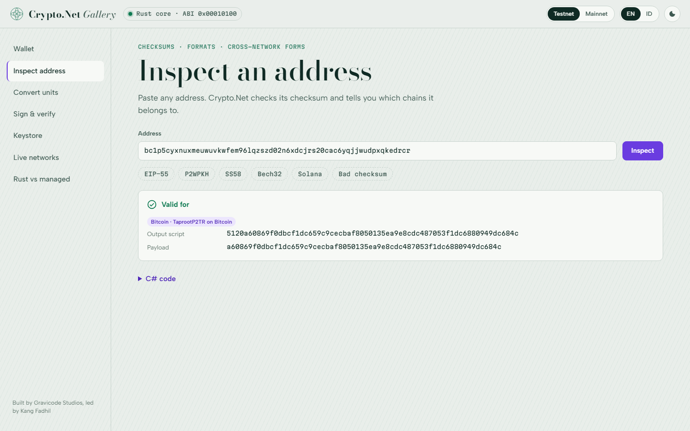
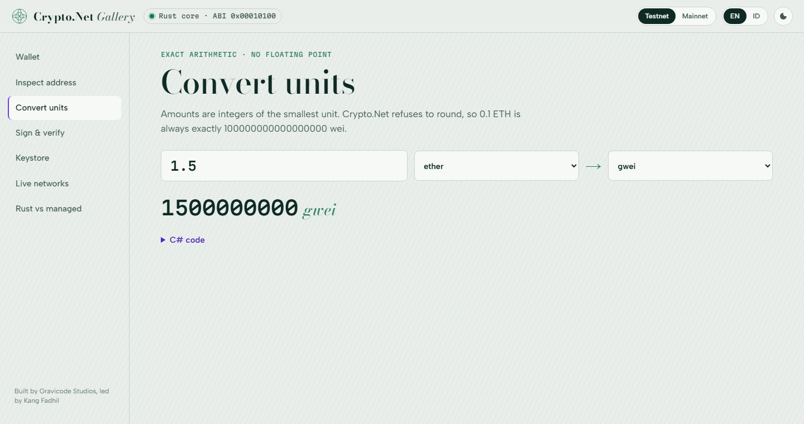
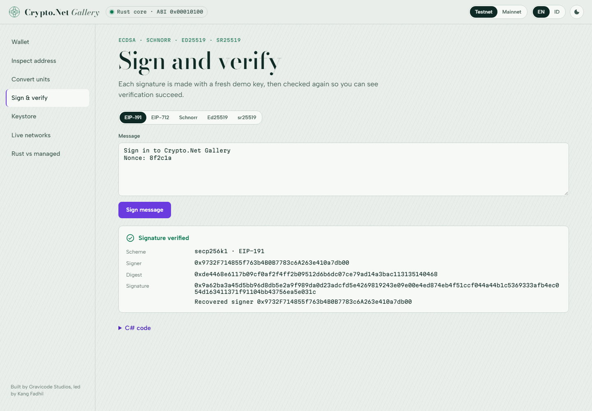
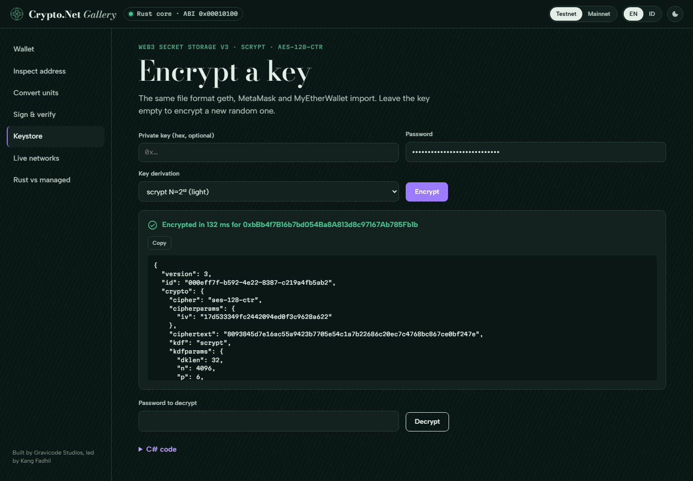
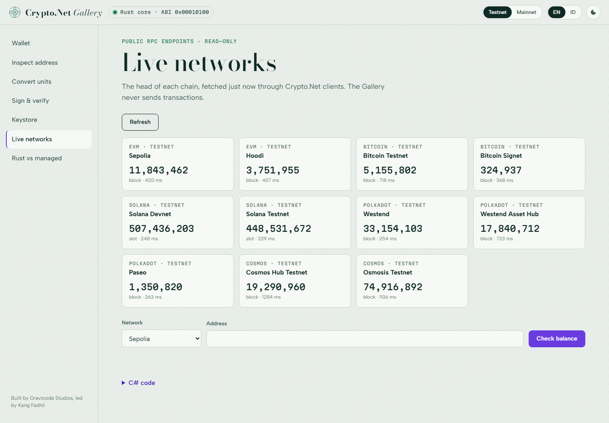
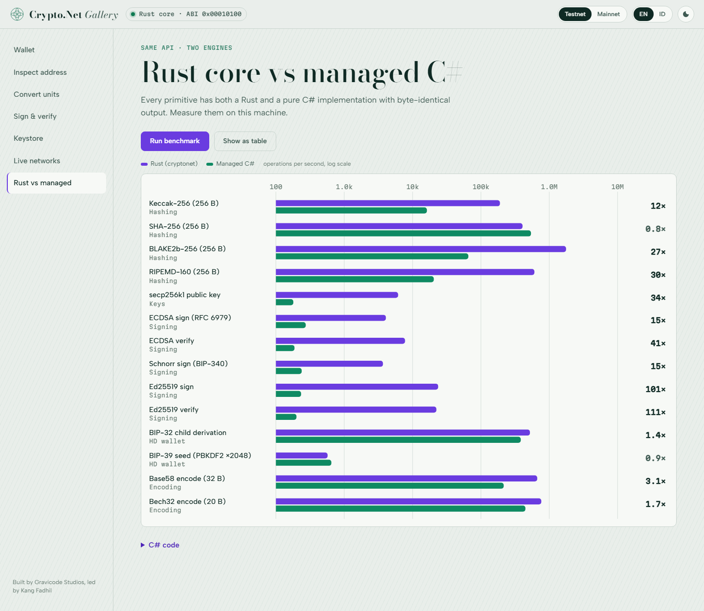
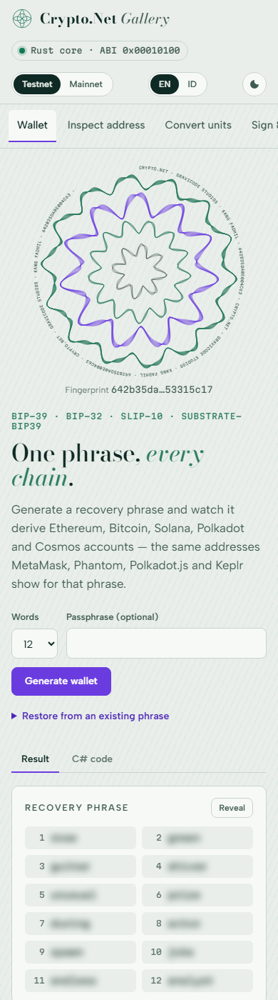
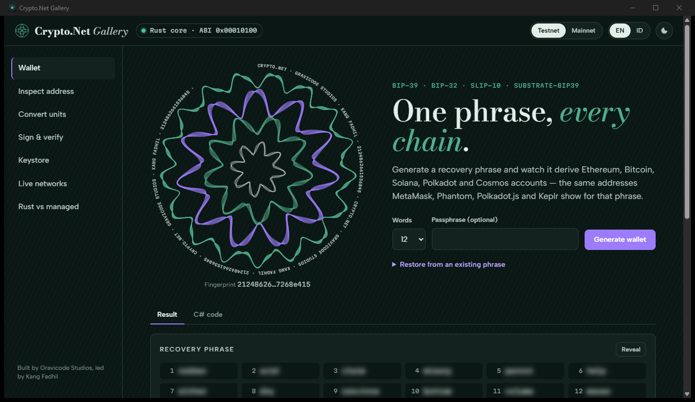
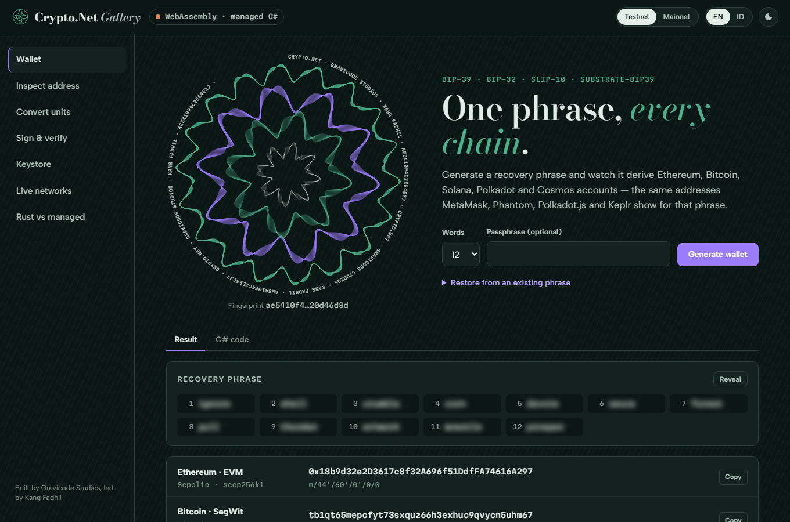

# Gallery

[← Dokumentasi](index.md) · [English](../en/gallery.md)

Gallery adalah studio interaktif untuk setiap fitur Crypto.Net. Setiap halaman menjalankan library sungguhan di server
dan menampilkan kode C# yang melakukan hal yang sama.

```bash
dotnet run --project samples/Crypto.Net.Gallery
# buka http://localhost:5080
```

Isi `CRYPTONET_ANKR_KEY` / `CRYPTONET_DRPC_KEY` sebelum menjalankannya agar jaringan dibaca lewat penyedia Anda.

**Sandbox aman.** Gallery tidak pernah mem-broadcast transaksi. Kunci yang dibuatnya adalah kunci demo yang hanya
hidup di memori selama satu permintaan. Testnet adalah default; beralih ke mainnet menampilkan banner peringatan.

| Halaman | Yang bisa dilakukan |
| --- | --- |
| Dompet | Membuat atau memulihkan frasa dan melihat akun Ethereum, Bitcoin SegWit/Taproot, Solana, Polkadot dan Cosmos. Rosette guilloché adalah sidik jari visual yang digambar dari xpub dompet, bukan dari rahasianya. |
| Periksa alamat | Tempel alamat apa pun untuk melihat chain yang menerimanya, script output-nya, dan bentuknya di jaringan lain. |
| Konversi satuan | Konversi pasti antar semua satuan sebuah chain, langsung saat mengetik. |
| Tanda tangan | Tanda tangan EIP-191, EIP-712, Schnorr BIP-340, Ed25519 dan sr25519, masing-masing diverifikasi ulang. |
| Keystore | Mengenkripsi kunci ke berkas Web3 v3 lalu mendekripsinya kembali. |
| Jaringan langsung | Blok terbaru setiap jaringan lewat client Crypto.Net, ditambah pengecekan saldo. |
| Rust vs managed | Benchmark kedua mesin dengan grafik (skala log) atau tabel. |

Bahasa antarmuka: Inggris dan Indonesia (tombol EN/ID). Tema: terang dan gelap, mengikuti sistem secara default.
Tata letak berfungsi hingga lebar layar ponsel.










Parameter URL untuk screenshot dan demo: `?theme=light|dark`, `?lang=en|id`, `?still=1` (tanpa animasi),
`?autorun=1` (menjalankan aksi halaman saat dibuka).

## Desktop dan WebAssembly

UI yang sama berjalan di tiga host. Ketiganya memakai `Crypto.Net.Gallery.Core`, sehingga setiap halaman berperilaku
identik.

| Host | Menjalankan | Mesin |
| --- | --- | --- |
| Web (ASP.NET Core) | `dotnet run --project samples/Crypto.Net.Gallery` | Inti Rust |
| Desktop: jendela native di Windows, macOS dan Linux (Photino; WebView2 / WKWebView / WebKitGTK) | `dotnet run --project samples/Crypto.Net.Gallery.Desktop` | Inti Rust |
| Browser, PWA yang bisa offline (.NET WebAssembly) | `dotnet publish samples/Crypto.Net.Gallery.Wasm -c Release -o out`, lalu sajikan `out/wwwroot` | C# managed |



Aplikasi desktop menjalankan server Gallery di dalam proses pada port `127.0.0.1` acak. Tidak ada yang mendengarkan di
antarmuka lain.

Build WebAssembly menjalankan seluruh API di dalam halaman: `host.js` menyalakan .NET dan `app.js` memanggilnya alih-alih
`/api`. Tidak ada server, sehingga bisa di-hosting di situs statis mana pun (GitHub Pages, CDN) dan dipasang di ponsel
sebagai PWA. Ada dua batasan di browser: inti Rust tidak tersedia, sehingga tanda tangan sr25519 (Polkadot) dinonaktifkan;
dan halaman jaringan langsung hanya bekerja dengan endpoint RPC yang mengizinkan CORS.



CI mem-publish build WebAssembly (artifact `gallery-wasm`) dan memeriksanya di Chrome headless: halaman harus berhasil
menyalakan .NET dan menurunkan dompet.
