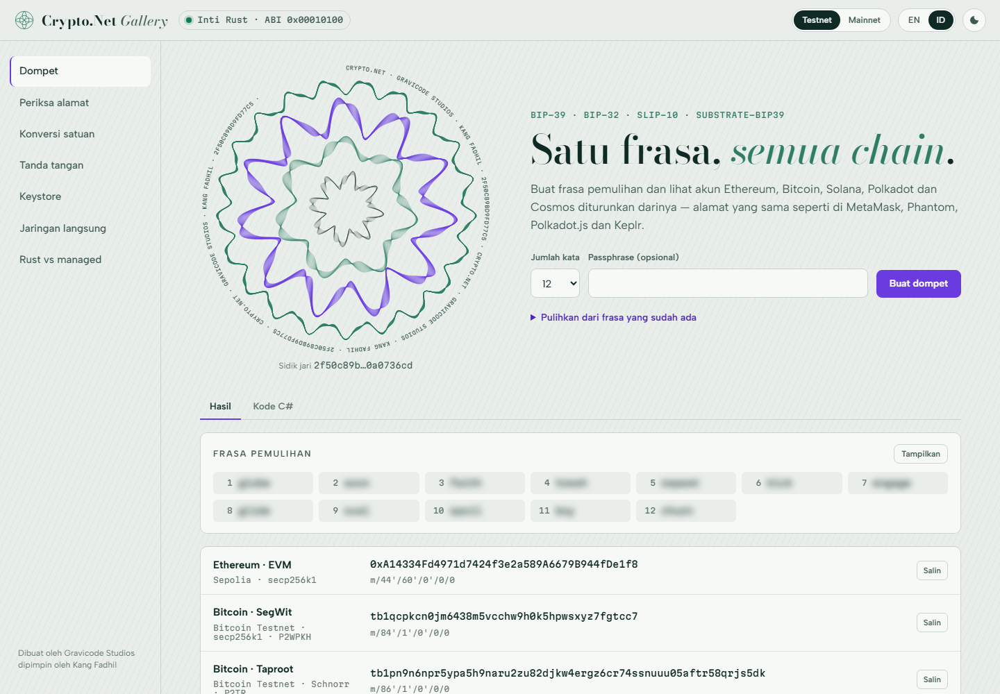

# Dokumentasi Crypto.Net

> Kriptografi multi-chain dan client blockchain untuk .NET 10, ditenagai inti Rust.
> Dibuat oleh Gravicode Studios dipimpin oleh Kang Fadhil. · [English](../en/index.md)

## Mulai dari sini

| Halaman | Baca jika Anda ingin… |
| --- | --- |
| [Memulai](memulai.md) | memasang paket dan membuat dompet, tanda tangan serta transfer pertama |
| [Konsep](konsep.md) | memahami `Amount`, `Address`, `ISigner`, `IChainClient`, backend dan error |
| [Chain](chain.md) | memakai Ethereum/EVM, Bitcoin, Solana, Polkadot, Cosmos, NEAR, Aptos, Sui, TON atau Cardano secara mendalam |
| [Dompet dan kunci](dompet-dan-kunci.md) | bekerja dengan mnemonic, derivasi HD, xpub dan keystore |
| [Dependency injection dan penyedia RPC](dependency-injection.md) | mendaftarkan client di ASP.NET Core, menambah Ankr/dRPC, resilience |
| [CLI `cnet`](cli.md) | mengotomatiskan dompet, saldo dan tanda tangan dari terminal |
| [Gallery](gallery.md) | menjelajahi setiap fitur secara interaktif |
| [Arsitektur](arsitektur.md) | melihat bagaimana inti Rust, C ABI dan fallback managed saling terhubung |
| [Keamanan](keamanan.md) | menjalankan di produksi dengan aman |
| [Client kontrak](codegen.md) | membuat C# bertipe dari ABI Solidity dan IDL Anchor |
| [Indexer](indexer.md) | mengindeks event EVM dan transfer ERC-20 ke database, atau menelusuri blok di chain mana pun |
| [Template project](template.md) | memulai aplikasi console, worker, Web API, library atau project test dengan `dotnet new` |
| [WalletConnect](walletconnect.md) | terhubung ke wallet mobile pengguna; wallet yang menandatangani |
| [Hardware wallet](hardware-wallet.md) | menandatangani dengan Ledger atau Trezor: kunci tetap di perangkat |
| [Ekstensi VS Code](vscode.md) | cek saldo, membuat client, hover unit dan menangkap salah ketik alamat di editor |
| [Analyzer](analyzer.md) | menangkap kunci hard-coded, amount dari float dan kesalahan lain saat kompilasi |
| [Build dan kontribusi](kontribusi.md) | build dari source, menjalankan test, merilis paket |
| [FAQ](faq.md) | mencari jawaban cepat |
| [Notebook](../../samples/notebooks/README.md) | mempelajari setiap chain secara interaktif di Polyglot Notebooks |

## Apa saja yang didukung

| | Bitcoin | Ethereum / EVM | Solana | Polkadot / Substrate | Cosmos SDK |
| --- | --- | --- | --- | --- | --- |
| Kurva / skema | secp256k1 ECDSA, Schnorr BIP-340 | secp256k1 ECDSA | Ed25519 | sr25519, Ed25519 | secp256k1 ECDSA |
| Alamat | P2PKH, P2SH, P2WPKH, P2WSH, P2TR | EIP-55 | Base58, PDA, ATA | SS58 (prefix apa pun) | Bech32 (HRP apa pun) |
| Path HD | BIP-44/84/86, xpub/zpub | BIP-44 (MetaMask) | SLIP-10 (Phantom) | substrate-bip39 `//hard/soft` | BIP-44 coin 118 |
| Transaksi | Legacy, SegWit v0, Taproot key/script path; PSBT v0/v2; multisig; coin selection | Legacy (EIP-155), EIP-2930, EIP-1559; user operation ERC-4337 | Message legacy dan v0 dengan lookup table: System, SPL Token, ATA, Compute Budget, Memo, ALT | Extrinsic v4 dari metadata runtime live | `SIGN_MODE_DIRECT`: bank, staking, distribution |
| Tanda tangan off-chain | — | EIP-191, EIP-712 | Pesan Ed25519 | `signRaw` Polkadot.js | — |
| RPC | REST Esplora | JSON-RPC | JSON-RPC | JSON-RPC | REST (LCD) |
| Token | — | ERC-20 | SPL Token | saldo native | saldo bank |

| | NEAR | Aptos | Sui | TON | Cardano |
| --- | --- | --- | --- | --- | --- |
| Kurva / skema | Ed25519 | Ed25519 | Ed25519 (intent) | Ed25519 | Ed25519 (BIP32-Ed25519) |
| Alamat | akun implicit (hex) dan bernama | hex AIP-40 | 0x + 64 hex | raw `0:` dan ramah pengguna `EQ…`/`UQ…` | Bech32 base/enterprise/reward, Byron |
| Path HD | SLIP-10 `m/44'/397'` | SLIP-10 `m/44'/637'` (Petra) | SLIP-10 `m/44'/784'` | mnemonic TON; SLIP-10 `m/44'/607'` | CIP-1852 (Icarus) |
| Transaksi | Borsh, 8 action | entry function BCS, simulasi | programmable transaction BCS | Cell/BoC, wallet V4R2 dan W5 | CBOR Conway, native asset, CIP-20 |
| RPC | JSON-RPC | REST | GraphQL | TON Center v2/v3 | REST Koios |
| Token | NEP-141 lewat view/function call | coin dan fungible asset | objek coin | jetton | native asset |

Jaringan bawaan: Ethereum, Sepolia, Hoodi, Polygon, Arbitrum, Optimism, Base, BNB Chain, Avalanche, Anvil lokal;
Bitcoin mainnet/testnet/signet/regtest; Solana mainnet/devnet/testnet/lokal; Polkadot, Kusama, Asset Hub keduanya,
Westend, Paseo, lokal; Cosmos Hub (+ testnet), Osmosis (+ testnet), `simd` lokal; mainnet dan testnet NEAR, Aptos, Sui dan
TON; Cardano mainnet, preprod dan preview. Jalankan `cnet networks` untuk daftarnya.

Item roadmap (indexer, WalletConnect, hardware wallet, ekstensi VS Code, template, Gallery mobile) dicatat di
[PLAN.md](../../PLAN.md).
